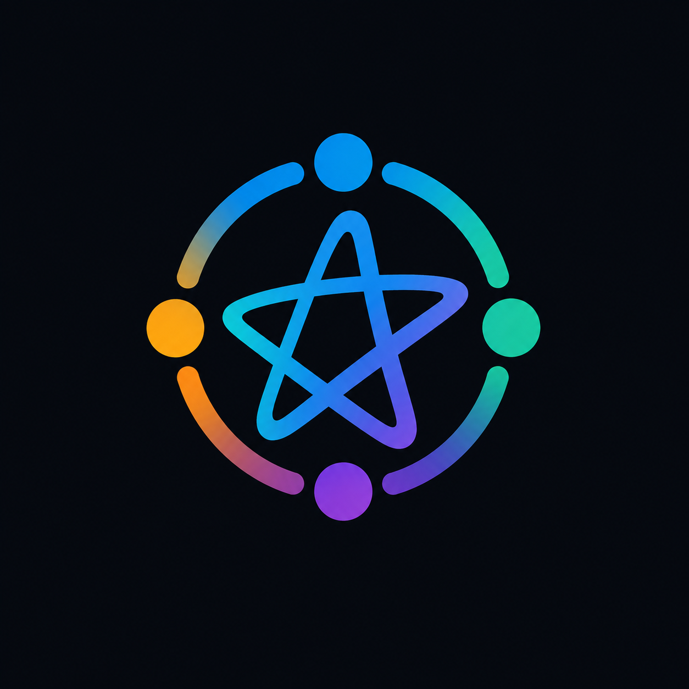

# Conexão TI

### O ponto de encontro dos estudantes de Tecnologia.

> **Um só lugar para tirar dúvidas, compartilhar projetos, receber avisos e acessar materiais da faculdade.**
>


---

## 💡 O Projeto

A **Conexão TI** nasceu de uma ideia simples: ninguém aprende tecnologia sozinho.

Todos os dias, alunos de TI precisam das mesmas coisas — um resumo que salve a prova, uma resposta para aquela dúvida que ninguém explicou direito, um lugar para mostrar o projeto que levou semanas, ou simplesmente saber o que está acontecendo na comunidade.

O problema é que tudo isso ficava espalhado: um PDF perdido no WhatsApp, um aviso que só quem viu o story soube, uma dúvida repetida dez vezes no grupo, um projeto incrível que ninguém ficou sabendo.

**Este site existe para centralizar tudo isso em um só lugar.**

Não é só uma página bonita — é a casa digital da comunidade. Um hub onde o conhecimento circula, os projetos ganham visibilidade e ninguém fica de fora dos avisos.

---

## 🎯 O Que Você Encontra Aqui

### 📢 Avisos e Novidades
Fique por dentro do que acontece na comunidade: eventos, workshops, oportunidades de estágio, novas parcerias e atualizações importantes. As publicações do Instagram e do LinkedIn aparecem direto na página inicial — sem precisar caçar em várias redes.

### ❓ Dúvidas e Respostas
As perguntas que todo aluno faz, respondidas pela coordenação e pelos veteranos. Organizadas por categoria e com busca rápida, para você encontrar a resposta sem precisar perguntar de novo.

### 💼 Projetos da Comunidade
Um espaço para mostrar o que os alunos constroem. Repositórios, ferramentas e iniciativas abertas — cada projeto com sua descrição e link direto para o GitHub, pronto para receber contribuições e feedback.

### 📚 Biblioteca de Materiais
Resumos, slides, provas anteriores, exercícios resolvidos e códigos de aula, organizados por matéria e conectados ao Google Drive coletivo. Tudo o que você precisa para estudar, em um só lugar.

### 🤝 Canais Oficiais
Instagram, LinkedIn (página e grupo), Discord e WhatsApp — todos os canais da comunidade reunidos, com links diretos para você entrar e participar.

### 👥 Quem Faz Acontecer
Conheça os administradores da comunidade: as pessoas por trás da moderação, do conteúdo, dos eventos e dos projetos. Porque comunidade não é só um grupo — é gente que se dedica para manter tudo funcionando.

---

## 🧭 A Experiência

O site foi desenhado para ser **rápido, direto e acessível**:

- **Abre com duplo clique.** Sem instalação, sem servidor, sem complicação. Funciona até offline.
- **Identidade visual própria.** Tema escuro, tipografia marcante e um design que não parece template genérico.
- **Feito para o aluno.** Navegação simples, busca em tudo, e cada seção resolve um problema real do dia a dia na faculdade.
- **Conteúdo vivo.** A biblioteca atualiza direto do Drive, os posts vêm das redes oficiais e as dúvidas são editáveis pela coordenação.

---

## 🚀 Como Acessar

### Do jeito mais simples
Abra o arquivo principal no navegador:

```
main/index.html
```

Pronto. O site inteiro funciona localmente.

### Publicado na web
O projeto é 100% estático — pode ser hospedado em qualquer lugar: GitHub Pages, Netlify, Vercel, Cloudflare Pages ou qualquer servidor.

### Para a coordenação (configuração)
A biblioteca usa a API do Google Drive para listar as pastas e os arquivos reais. Para ativar:

1. Copie `main/js/config.js.example` para `main/js/config.js`
2. Preencha `apiKey` com sua chave do Google Cloud (Drive API v3 habilitada)
3. O `parentFolderId` já vem com a pasta raiz da Biblioteca Coletiva

```
main/js/config.js.example  →  main/js/config.js
```

> `config.js` não é versionado (fica no `.gitignore`). Sem a chave, a biblioteca continua funcionando: exibe as pastas cadastradas em `main/js/biblioteca-dados.js` com links diretos para o Drive — só não lista os arquivos internos nem a contagem automática.
>
> A chave precisa estar liberada para o domínio de publicação no Google Cloud. A chave atual está restrita a `https://conexao-ti.vercel.app/`; em `localhost` a API responde `403` e o site usa o fallback automaticamente.

### Deploy na Vercel
O deploy é automático via GitHub. Como o `config.js` não é versionado, ele é gerado durante o build:

1. Em **Project Settings → Environment Variables**, crie `GOOGLE_DRIVE_API_KEY` com a chave do Drive (marque Production e Preview).
2. Opcionalmente, defina `GOOGLE_DRIVE_PARENT_FOLDER_ID` para sobrescrever a pasta raiz.
3. O build já está configurado em `main/vercel.json` (Root Directory = `main`) e no `vercel.json` da raiz (caso o projeto use a raiz do repositório).
4. Faça um **Redeploy** depois de criar ou alterar a variável.

O script `main/scripts/generate-config.js` roda no build e cria `main/js/config.js` com os valores das variáveis. Se a chave não estiver definida, o build continua e a biblioteca usa o fallback.

---

## 🛠️ Por Dentro

Construído de forma artesanal, sem framework de aplicação:

- **HTML semântico** + **Bootstrap 5.3** para a base responsiva
- **CSS autoral** com design system próprio (tema escuro, gradientes, animações e componentes)
- **JavaScript sem framework** para renderização de conteúdo, filtros e integrações (funciona via `file://`)
- **Google Drive API v3** para a biblioteca de materiais
- **Embeds oficiais** do Instagram e LinkedIn para os posts da comunidade
- **Sem build, sem dependências de instalação** — o site é o próprio produto

---

## 👥 Contribuidores

| Nome | Papel |
|------|-------|
| **Gabriel** | Idealizador e desenvolvedor — arquitetura do site, integrações (Drive e redes sociais), design system, conteúdo e documentação |
| **Douglas Viktor** | Desenvolvimento e revisão — estrutura, refatoração de estilos e melhorias de interface |

> E a todos os alunos da **Conexão TI** que compartilham materiais, tiram dúvidas, mostram seus projetos e mantêm a comunidade viva.

---

## 📄 Licença

MIT — livre para usar, estudar e adaptar.

---

## 🔗 Onde Nos Encontrar

| Canal | Link |
|-------|------|
| 📸 Instagram | [@conexaoti_](https://www.instagram.com/conexaoti_/) |
| 💼 LinkedIn (Página) | [Conexão TI](https://www.linkedin.com/company/conex%C3%A3o-ti/home/) |
| 💼 LinkedIn (Grupo) | [Grupo Conexão TI](https://www.linkedin.com/groups/40314001/) |
| 🎮 Discord | [Entrar no servidor](https://discord.gg/K5qquv4TfA) |
| 📁 Google Drive | [Biblioteca Central](https://drive.google.com/drive/folders/1N5kTne7aYPXn-N57nHIgYAUfW1V-5Uzx) |
| 💬 WhatsApp | [Grupo Oficial](https://chat.whatsapp.com/GV7oWrSgWoIJ9DYlEh9h18) |

---

<div align="center">

**Ninguém aprende tecnologia sozinho.  
Aqui, o conhecimento circula.**

*Conexão TI · Feito de alunos para alunos*

</div>
